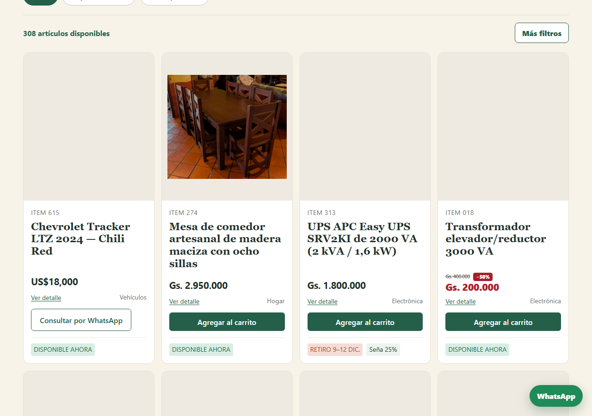
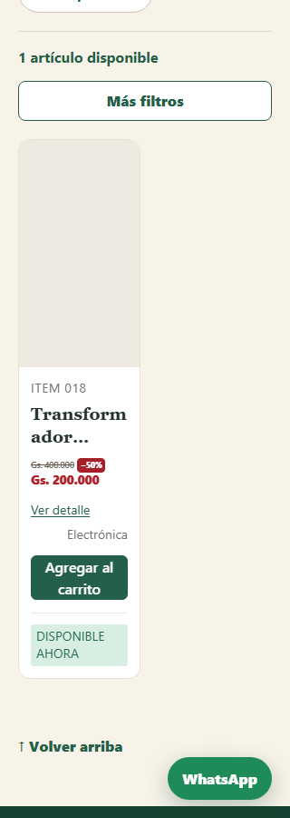
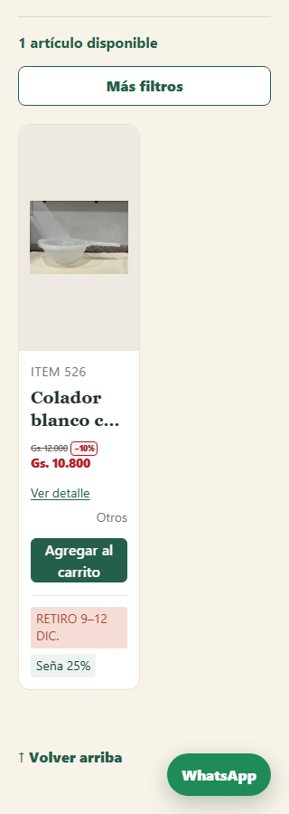
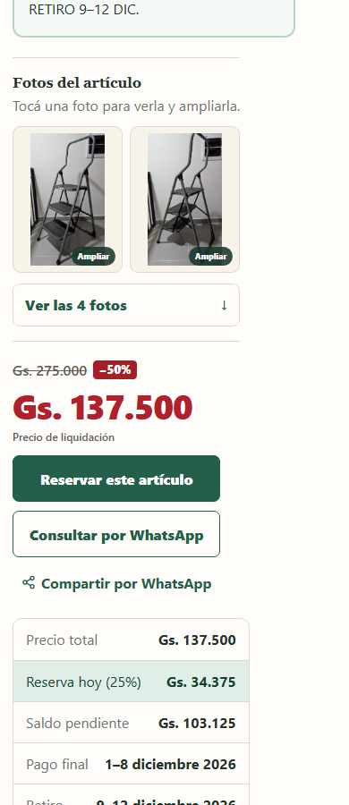

# Final liquidation — Governance review, November 13, 2026

Draft implementation only. No merge, deploy, hosted migration, marketing publication,
Admin override write, or live inventory repricing was performed.

## Source and pricing

- Base: `2fea836e73ffbead5bc0a98683b09fed304d0fd8`, branch
  `fix/catalog-price-order-20261109`. Its storefront asset matches production.
  Main lacks the later inventory/Tracker release; this PR deliberately targets the
  production branch so that Governance sees only the liquidation change.
- Calculate the offer after current Admin overrides and committed inventory are
  resolved. Positive, whole-guarani PYG asking prices at/below 12,000 receive 10%;
  higher prices receive 50%. No export prices are imported or written to Admin.
- Require AVAILABLE status, remaining quantity, and a current operational row with
  stock after active CART/ORDER holds. Missing or fully held stock gets no offer.
  Other customers cannot take an existing hold; the normal transaction locks remain.
- Exclude Items 274, 313 and 615. Current Admin/public readback: 274 is **Gs. 2,950,000**
  (older source: 3,800,000); 313 is **Gs. 1,800,000** (source: 1,200,000);
  615 remains **US$18,000**, private inquiry, with household checkout prohibited.
  Override precedence reconciles the differences; no source-sync or silent repricing.
- Round each discounted unit price to the nearest whole guarani, half upward.
  Retain the existing per-unit deposit rounding, then multiply by quantity;
  future balance is the exact remainder. Example: 26,301 → 13,151, deposit 3,288 per unit.
- New discounted delayed sales use the assignment's 25% deposit policy. Current
  available Items 405 and 441 contain 100% delayed-deposit values; these are preserved
  in Admin and existing agreements, while their new liquidation offers use 25%.
  Existing payment/pickup windows remain unchanged.

## Commitments and presentation

An additive nullable `pricing_snapshot` on cart reservations freezes server-resolved
unit prices, sale mode and deposit percentage when claimed. Quantity updates retain
the snapshot. Checkout uses it and rechecks it under existing transaction locks.
Pre-existing NULL snapshots keep the undiscounted Admin price path; existing order,
payment and reservation records are never backfilled or repriced. Admin retains
original asking prices, and order lines retain the liquidation calculation metadata.

The Spanish homepage banner appears only when the campaign is enabled. Cards group
the struck-out original and percentage above the red price. The optional card label
is omitted to preserve height; detail pages include it. At narrow widths, titles
use two lines with ellipsis and retain the full accessible detail-link name. A small
320px header image adjustment removes pre-existing horizontal overflow.

## Validation and final review

- Full Node suite: **889 passed, 0 failed, 7 optional PostgreSQL checks skipped**.
  After the deposit-policy correction: **33 focused checks passed**.
- Real isolated PostgreSQL-compatible cart/order transactions cover both tiers,
  odd-price rounding, quantities, committed stock, pre-migration reservations,
  protected Items, Admin overrides, accepted-price retention after reversal and
  Admin edits, checkout idempotency and immutable order snapshots. No hosted DB used.
- Local browser: **18 before/after card comparisons**, desktop/390px/320px, all
  heights unchanged or smaller; no price clipping, horizontal overflow or JS errors.
  Checked 50%/10%, long titles, per-unit prices, protected products, direct links,
  search and existing effective-price sort. Existing discovery tests cover filters.
- Actual local cart/checkout: Items 109 + 526 total **Gs. 148,300**, 25% due now
  **Gs. 37,075**, future balance **Gs. 111,225**. Immediate-purchase totals and
  order creation are exercised by the transaction test. All media/descriptions retained.
- Final “What did we forget?” review checked personalised catalog no-store caching,
  reserved stock, stale/expired cart rejection, rollback/accepted-price preservation,
  protected USD inquiry, Admin drift reporting, sharing, and existing notification paths.
  Marketing generation/desktop marketing desk remain unchanged; saved marketing copy
  should be reviewed separately before any later publication.

## Owner decision and release conditions

Ready for owner review; **not authorized for merge/deployment**. Resolve/accept the
reported deposit exceptions and hold-duration discrepancy: production currently uses
**two-hour** cart/order holds, whereas the assignment mentions 15 minutes. This change
preserves the deployed timing rather than changing reservation policy.

Campaign defaults OFF unless `FINAL_LIQUIDATION_ENABLED=true`. For a single approved
release, retain the production publication lock, apply `20261113_cart_pricing.sql`
through the normal migration-before-publication gate, configure the flag in that
approved build, then publish only with David's authorization. Do not merge this
isolated production baseline into stale main without Governance's integration decision.
Disable the flag to stop new offers; accepted cart prices and existing orders remain
honored. Keep the additive column and code until those commitments expire/complete;
never restore an old database or undo later transactions.
