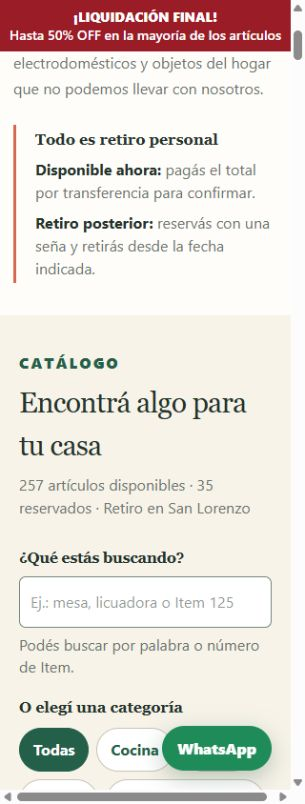
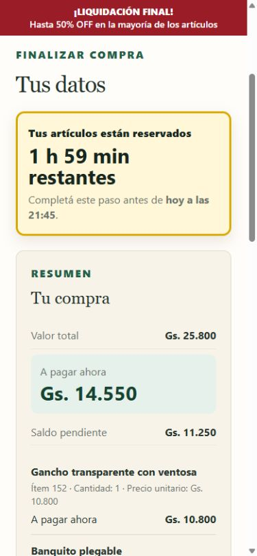
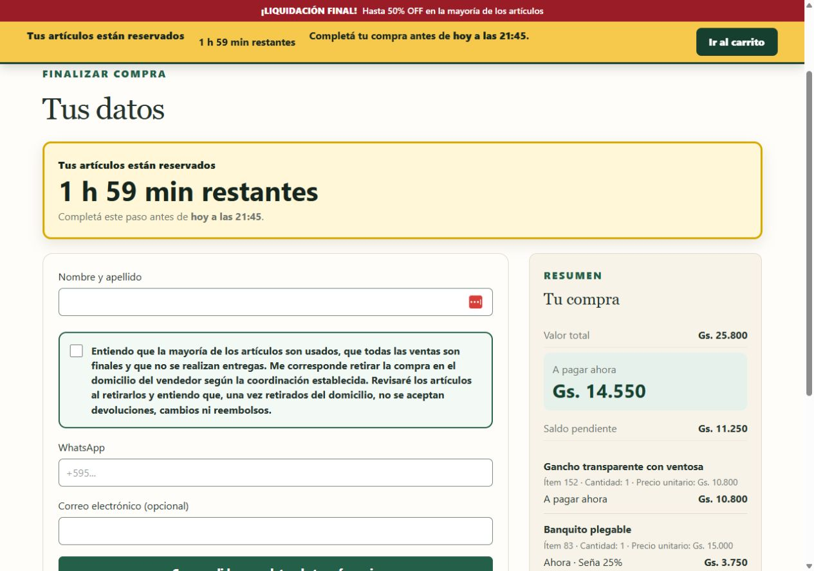

# Liquidation announcement wording

Replace the sticky promotion with the owner-approved text:

**¡LIQUIDACIÓN FINAL!**

**Hasta 50% OFF en la mayoría de los artículos**

The shared HTML shell serves catalog, product detail, cart, and checkout. The red
background and white text remain. Text stays 14px, including at 320px, with two
lines on mobile (54px strip) and one line on desktop (34px strip). A shared CSS
height variable sets the scroll padding and desktop cart-reservation offset.
Scoped child typography avoids the site's generic 16px span/strong rule enlarging
the new text beyond its compact container. The pickup-only notice stays above
the promotion and scrolls away normally. Campaign activation behavior is unchanged.

Only `index.html` announcement markup and scoped `css/liquidation.css` presentation
rules change at runtime. Discount rules, exclusions, catalog data, accepted prices,
checkout calculations, transaction handlers, database and Admin behavior are unchanged.

Validation uses a disposable local database and catalog fixture, with no production
writes. All four pages passed at 320px, 390px, and 1280px: **12 browser checks**.
The strip remains at top zero after scrolling, the pickup notice scrolls offscreen,
both text lines fit, white/red colors remain, and desktop reservation offset is 34px.
Scroll padding is 62px mobile and 42px desktop. Local mixed-cart totals remain
25,800 total / 14,550 due now / 11,250 balance, including a 25% delayed deposit.

**19 focused tests pass** in liquidation, public purchase availability, and storefront
loading orchestration. `git diff --check` passes. The existing 320px header navigation
overhang (about 8px in a browser with a vertical scrollbar) is outside this banner;
the banner text itself fits. No header styles change.

Based on verified production SHA `02506aee4992e9a06591daf17c15aca41f68bdfb`, targeting
`fix/catalog-price-order-20261109`. No merge, deployment, campaign setting change,
Admin edit or hosted migration is authorized by this PR preparation. Production
publishing remains locked. Exact-head owner approval is required before release.

## Local review screenshots

