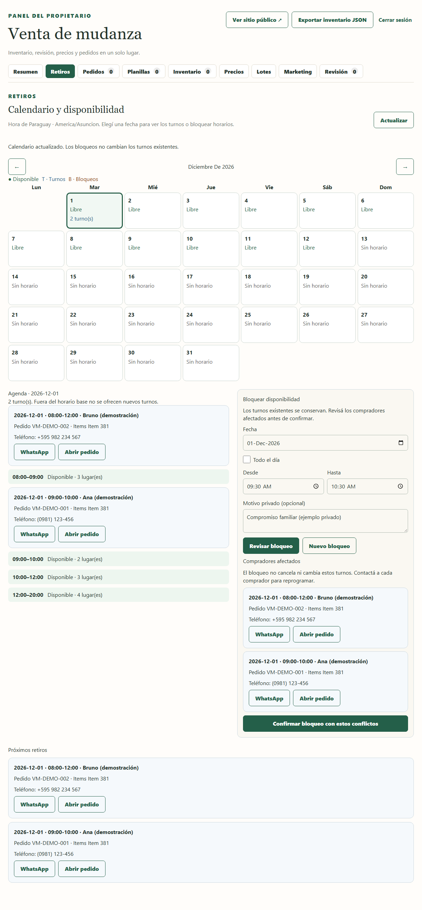
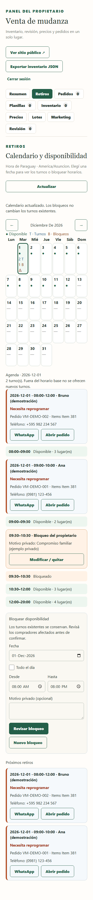

# Retiros calendar — Governance review

This implements the consolidated November 2, 2026 scope and supersedes the earlier pickup-blackout proposal. Draft only: merge, deployment, migration execution against hosted databases, and owner production acceptance remain pending. No live appointments or other operational records were read or changed during implementation/testing.

## Owner walkthrough

1. Open **Retiros**, immediately after Resumen. Revisión remains available after Marketing. Próximos retiros now lives here; each order's pickup editor remains under Pedidos.
2. Move between months and select a date. The chronological agenda shows appointments, buyer names, order and Item numbers, telephone, WhatsApp and Abrir pedido actions, remaining capacity, and blocked ranges. Mobile uses compact calendar markers and a full-width daily list.
3. Select Todo el día or a time range, optionally add a private reason, then choose **Revisar bloqueo**. The review lists every overlapping buyer, including legacy half-day appointments, with their contact and order actions.
4. Confirm, including conflicts if necessary. Appointments retain their existing status, slot, revision and notifications. Overlapping appointments display **Necesita reprogramar** until rescheduled/cancelled or the block is removed. Contacting a buyer opens WhatsApp; it sends no message automatically.
5. Add additional blocks, or use **Modificar / quitar**. Removing a block also requires an explicit confirmation. Existing appointments are preserved in every case.

These captures use fictional buyers, telephone numbers and orders in a disposable local database, running the committed UI and server handlers. They are test evidence, not a hosted/internal site preview.

### Desktop: calendar, blackout entry and actual conflict review

### Mobile: saved blackout and appointments requiring rescheduling

## Persistence, privacy and synchronization

- Additive migration: `netlify/database/migrations/20261102_pickup_blackouts.sql`. It creates only a new table/index and never rewrites existing appointments. Apply it through the normal migration workflow only after Governance authorizes release, before serving the new functions. Subsequent owner edits are database writes and require no redeploy.
- The existing seller credential represents the sole OWNER account; there is no separate multi-role account model in this repository. Both calendar reads and blackout mutations authenticate server-side and return `Cache-Control: no-store`. Buyer contacts and private reasons are absent from customer availability responses.
- Hourly display filters every slot overlapping a blackout, including partial-hour blocks. Booking checks blackouts again under the existing shared date row lock. Legacy half-day capacity and the limit of four overlapping appointments are preserved.
- Blackout preview/confirmation shares those date locks. Confirmation binds the exact candidate to the complete overlapping appointment data/revisions. A booking/reschedule committed after preview forces a fresh review instead of silently confirming unseen conflicts. Blackout editors also serialize with each other and check revisions to prevent stale edits/deletes. Date moves lock both dates in sorted order.
- Confirming a blackout does not change appointment/order statuses, payment or inventory records, or queue notifications. Existing booking/rescheduling/cancellation and notification behavior remains in its established pathways.
- Calendar/month/date reads and booking submissions reload persistent state without caching. The refresh button and returning to the tab provide fresh owner views; there is no third-party calendar or drag-and-drop system.
- Calendar and blackout-conflict queries use the same active-order status allowlist, explicit reservation-expiry check, and committed/deadline rules as PR #69. Inactive orders are excluded from these operational views, without deleting or updating their appointment/history rows.
- Retiros highlights its navigation button after the common active-class update. Recognized Paraguayan mobile forms such as `0981 123456`, `+595 981 123456`, `595981123456` and `00595981123456` produce digits-only international WhatsApp links. Ambiguous, malformed or extension-bearing numbers keep their original visible phone text and omit the link. Explicit international numbers retain their country code. See [WhatsApp's click-to-chat format](https://faq.whatsapp.com/5913398998672934/).

## December policy and PR #69 coordination

Only December 1, 5, 8 and 12, 2026 gain 08:00–20:00 base availability in America/Asuncion. December 8's previous exception is replaced. Other weekly hours remain unchanged. Immediate dates end December 8; delayed dates remain December 9–12, intersected with narrower Item windows. Blackouts subtract from these base hours.

This branch is based on `main` at `4ca6fced73dceb328e1a50799fdf62ba88db64c3`. It does not import PR #69's payment-independent scheduling policy. At initial delivery, a local-only combination with #69 head `a9667ee4345de31b02e083bd0ab48a046b544270` combined cleanly and passed all 816 tests. After Governance's three targeted corrections, that unchanged #69 head again combined cleanly and passed 218 focused checks, including payment-independent scheduling, SQL eligibility/history, native PostgreSQL concurrency, notifications, private links and desktop/mobile flows. Neither PR #69 nor main was modified. Recheck the combination if either branch changes before Governance authorizes merging.

## Verification

The initial implementation passed all 774 tests with zero failures/skips. The Governance follow-up passed 108 focused checks on this branch and 218 on the local #69 combination, with zero failures/skips. Coverage includes active/inactive order status and deadline cases, retained historical rows, populated-database migration preservation, phone normalization/uncertainty, tab highlighting, full-day/multiple blocks, partial overlaps and exact boundaries, legacy appointments, edit/delete revisions, changed conflict reviews, public authentication/privacy, December/Item limits, display/submission rejection, and both directions of a booking/blackout race. The seven concurrency scenarios ran on disposable local native PostgreSQL with independent connections; SQL behavior is also exercised in isolated PGlite databases. Desktop and 390px mobile browser flows verify navigation order/highlighting, conflict identities/contact links, create/edit/remove, opening the correct order, retained pickup editors, and no page/day-cell overflow.

Run `npm test` after installing dependencies and the Playwright Chromium browser. Set `PICKUP_TEST_DATABASE_URL` to a disposable **local** database whose name starts with `pickup_test_` to run the independent-worker tests; otherwise those seven tests explicitly skip. Set `RETIROS_DEMO_OUTPUT_DIR` to capture the synthetic walkthrough images.

Draft delivery uses `[skip netlify]` in the commit message and PR title to suppress automatic branch/preview deployment, following [Netlify's documented skip-deploy workflow](https://docs.netlify.com/deploy/manage-deploys/manage-deploys-overview/#skip-a-deploy). Do not remove those markers or trigger a deployment without Governance authorization.

## Release sequence — authorization still required

1. Governance approves the exact application heads and controlled integration. Before any merge into `main`, lock the currently published production deploy using Netlify's **Lock to stop auto publishing** control; positively verify the lock and unchanged published deploy. PR #70 remains draft until authorized. Keep deployment suppression during preparation.
2. Integrate approved #69 followed by #70 and validate the combined production build while the published deploy remains locked. Preserve `netlify/database/migrations/20261102_pickup_blackouts.sql` unchanged. Netlify's enabled native migration system recognizes this file; no separate manual SQL execution or new migration hook is required.
3. Obtain explicit publication approval for the exact combined commit and production deploy ID, then manually publish that production deploy through Netlify. With auto publishing disabled, Netlify waits until publication to apply pending migrations; they run immediately before the new code becomes live, and migration failure blocks publication. Verify successful migration completion and the new table/index/constraints. Recheck compatibility if either approved head changes; never bypass the migration gate.
4. Verify authenticated Admin views and customer availability without changing live appointments. Owner acceptance and any later blackout entry remain explicit owner actions. Preserve all existing and historical records.

No hosted migration, merge, deployment or live operational read/write was performed for this follow-up.
